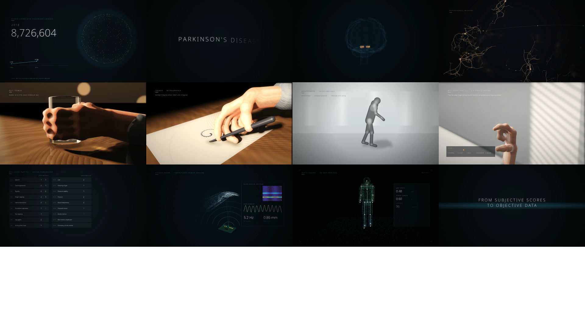
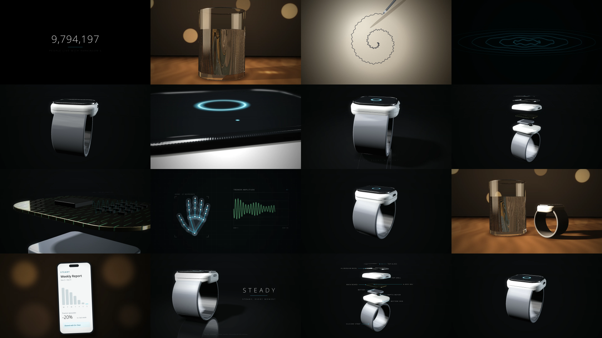

# 开篇片：从主观评分到客观数据（75 秒，最新）

患者数量增长 → 帕金森病 → 大脑黑质与神经元 → 手抖、写字、步态 → MDS-UPDRS 第三部分评估的局限 → 毫米波雷达测震颤、深度相机测步态。

| 文件 | 说明 |
|---|---|
| [开篇片_预览版_540p.mp4](开篇片/开篇片_预览版_540p.mp4) | 8 MB，快速预览 |
| [开篇片_75s_1080p.mp4](开篇片/开篇片_75s_1080p.mp4) | 1080p 成片，带配乐和内嵌中文字幕轨，95 MB |
| [开篇片_配乐.wav](开篇片/开篇片_配乐.wav) | 单独配乐 |
| [旁白字幕.srt](开篇片/旁白字幕.srt) | 旁白稿和时间轴，导入剪映可用"文本朗读"自动配音 |
| [开篇片_脚本与素材指南.md](开篇片/开篇片_脚本与素材指南.md) | 分镜、旁白、数据来源、实拍素材去哪找、AI 视频提示词 |

---

# （旧版）STEADY · 帕金森震颤腕戴设备 · 60 秒产品宣传片

## 成片（`成片/`）

| 文件 | 说明 |
|---|---|
| [STEADY_宣传片_预览版_540p.mp4](成片/STEADY_宣传片_预览版_540p.mp4) | 960×540，6.9 MB，适合手机上快速看 |
| [STEADY_宣传片_60s_1080p.mp4](成片/STEADY_宣传片_60s_1080p.mp4) | 1920×1080 主成片，H.264 + Opus 音频 + 内嵌中文字幕轨，65 MB |
| [STEADY_宣传片_60s_1080p_PCM音频.mov](成片/STEADY_宣传片_60s_1080p_PCM音频.mov) | 同一成片，无损 PCM 音频，Mac QuickTime / Premiere / 剪映兼容性更好，75 MB |
| [STEADY_配乐音效.wav](成片/STEADY_配乐音效.wav) | 单独的配乐和音效，48 kHz 立体声 |
| [中文字幕.srt](成片/中文字幕.srt) | 中文字幕，导入剪映或 Premiere 可直接压进画面 |
| [预览_16帧.png](成片/预览_16帧.png) | 从成片截取的 16 帧缩略图 |

在 GitHub 上点开视频文件后，点 **View raw** 或下载按钮即可播放。

## 分镜（14 个镜头）

| 时间 | 内容 |
|---|---|
| 0–16 秒 | 患者人数计数 → 抖动的水杯 → 歪斜的螺旋线 → 涟漪化为震颤波形 |
| 16–30 秒 | 暗场扫光亮相 → 呼吸灯微距 → 360° 倒影展示 |
| 30–50 秒 | 爆炸图与零件标注 → IMU 芯片 + 4–6 Hz 波形 → AI 手部骨骼追踪 → 合体 |
| 50–60 秒 | 平静的水杯与设备 → App 周报 → Logo |

完整分镜表、SolidWorks Visualize 渲染参数和参考视频见 [分镜脚本.md](分镜脚本.md)，可交互的动态分镜见 [动态分镜.html](动态分镜.html)。

## 投放前需要替换或核实

- 产品名 **STEADY**、标语 **STEADY, EVERY MOMENT** 是占位
- App 周报里的数字是演示数据
- 结尾 `Reg. No. XXXXXXXX` 需换成真实医疗器械注册证号；国内投放医疗器械广告需先通过广告审查
- 开头"1000 万患者"请按最新流行病学数据核实
- 画面里的产品是概念 CG 模型，不是 SolidWorks 渲染；换成真实产品需用你的 CAD 在 SolidWorks Visualize 中重渲产品镜头

## 渲染源码（`render/`）

成片完全由代码生成：WebGL 光线步进渲染产品与水杯，Canvas 2D 做图形与合成，WebCodecs 编码 H.264，程序生成配乐，自写 MOV/MP4 封装。

- `render.html`：着色器（产品、材质、灯光、水杯）
- `film.js`：镜头、运镜、图形、配乐、编码；开头可改产品名和标语
- `mp4mux.js`：MP4 封装（视频 + Opus + 字幕轨）
- `preview.js`：生成低码率预览版

在 Chromium 内核浏览器中用 `file://` 打开 `render/render.html`，控制台执行 `run()` 即开始渲染，约 78 分钟（软件 GPU）。
